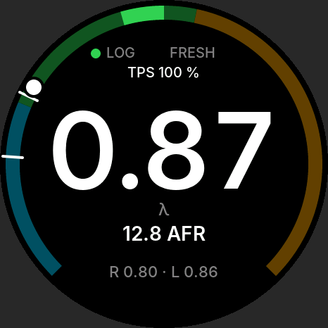
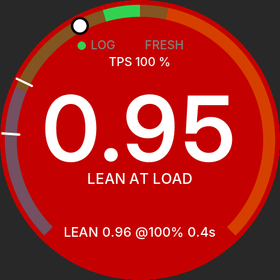
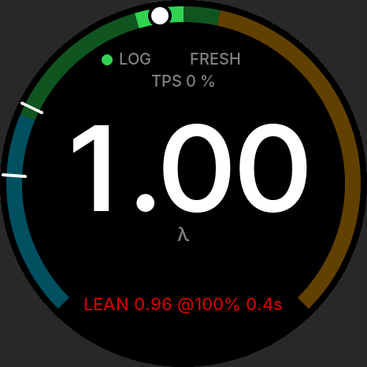
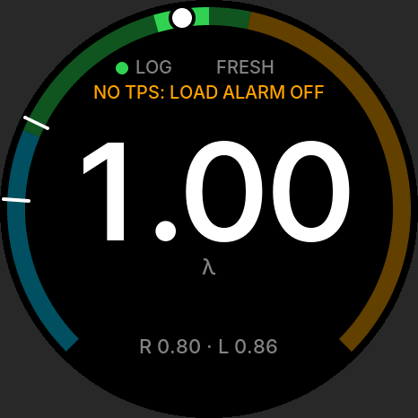
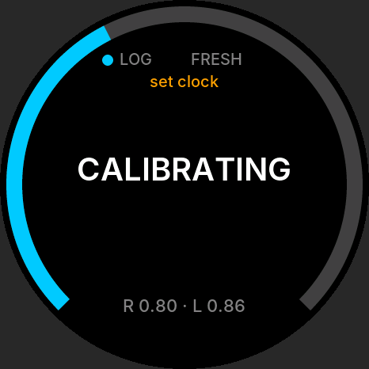
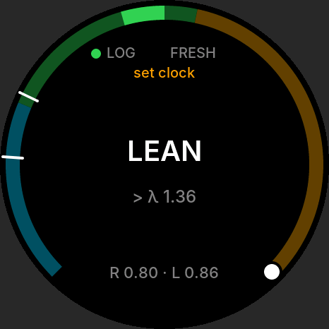
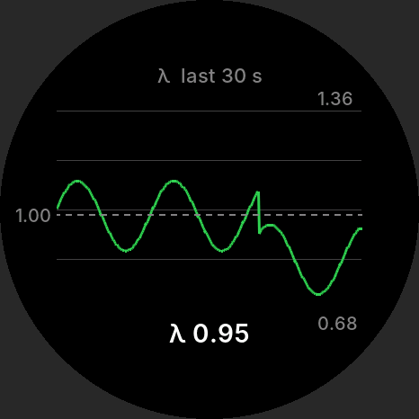
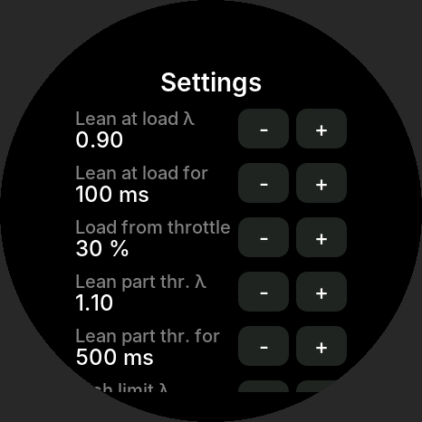

# Wideband AFR gauge

Firmware for a standalone in-car wideband lambda gauge built for drag racing. A 14Point7 Spartan 3 Lite v2 runs a Bosch LSU 4.9 sensor. Two ADS1115s on a Waveshare ESP32-S3-Touch-AMOLED-1.75 read it, and the board shows lambda/AFR on the 466 × 466 round screen. The gauge alarms on dangerous mixtures and logs every sample to microSD. It only displays and logs; it never feeds the ECU.

It is built from the *Wideband AFR Gauge – Technical Build Spec*, with the measurement chain upgraded for accuracy and throttle-aware alarms added (v2, below). Where the firmware departs from a design decision in the spec, the reason is under [Changes from the spec](#changes-from-the-spec).

| Ready, under load | Lean at load (alarm) | Alarm latched after the lift | No TPS signal |
| --- | --- | --- | --- |
|  |  |  |  |
| **Calibrating** | **Lean rail (fuel cut)** | **Strip chart** | **Settings** |
|  |  |  |  |

These are host renders of the real UI code through LVGL 9.4 (`test/ui_preview`). They are not photos of the panel.

## What it does, in numbers

| | |
| --- | --- |
| Lambda sampling | 860 SPS continuous, differential against the Spartan's own ground. Each conversion is timestamped by its ready pulse. |
| Processed rate | 215 Hz (blocks of 4: mean, or trimmed mean if one sample spikes) |
| Resolution | 0.00003 λ per ADC step, below the Spartan's own 12-bit DAC step (0.00017 λ) |
| Accuracy (simulated chain, every sample) | Within 0.002 λ from 0.5 to 4.5 V, after the start-up two-point calibration |
| Added delay | About 4.65 ms (one block) after the Spartan. The Spartan is held to its 10 ms response mode. |
| Lean at load alarm | Trips 100 ms after λ passes 0.90 with the throttle at or above 30 % (both adjustable) |
| Logging | Every 215 Hz sample, unsmoothed, with throttle and alarm columns. A 9.5 s queue rides out SD stalls. |

Everything runs at full rate all the time; there is no economy or cruise mode. Display smoothing (50 ms default) only affects the big number. Alarms, peaks and logs use the unsmoothed samples.

## Hardware v2

These changes to the spec's wiring are required by this firmware.

| Change | Why |
| --- | --- |
| **Second ADS1115**, ADDR to 3V3 (0x49), on the same I2C1 wires | It takes the LED, TPS and supply, so the first ADS1115 (ADDR to GND, 0x48) reads only lambda, continuously. |
| **Lambda read differentially**: green to AIN0, a **ground-sense wire** from the Spartan's black wire *at the Spartan* to AIN1, each through a 10 k/15 k divider | It cancels ground shift between the Spartan and the gauge under load (fuel pump, fans, alternator). The start-up calibration only removes a fixed offset. |
| **ALERT/RDY of the lambda ADS1115 to GPIO43** (header pin 5) through a **1 kΩ series resistor** | Each conversion is read once, timed to the microsecond. The resistor protects both pins: GPIO43 is the chip's UART0 TX and prints boot messages before the firmware takes it. |
| **220 nF** on the green and sense inputs (was 100 nF) | The input corner drops from 265 Hz to 120 Hz, so ignition noise doesn't alias into the reading. It adds about 1 ms of delay. |
| **TPS signal** (0–5 V) to the second ADS1115's AIN1 through a 10 k/15 k divider and 100 nF | The alarms need it to tell a lean-out at full throttle from fuel cut. |

**Second ADS1115 channels:** AIN0 blue LED wire, AIN1 TPS, AIN2 optional supply sense (47 k/10 k), AIN3 spare. Both chips run from 3V3 (header pin 3).

**BOM additions:** one ADS1115 breakout (~£5), four more 10.0 k/15.0 k 0.1 % resistors (sense and TPS dividers), two 220 nF C0G capacitors, one 1 kΩ resistor, one more core in the signal cable (ground sense), and a TPS tap (splice or T-harness).

**Ground-sense wire:** take it from the Spartan's black wire as close to the Spartan as you can, and run it inside the screened cable with the green wire. If it's ever left off, the divider pulls AIN1 to the gauge's ground and the gauge behaves like the v1 single-ended wiring.

## Alarms

Alarms are always armed. Lambda alone can't tell a lean-out at full throttle from fuel cut on the lift, because both go to the lean rail. So the lean alarms read the throttle.

| Alarm | Fires when | Default | Display |
| --- | --- | --- | --- |
| **LEAN AT LOAD** (danger) | Throttle ≥ load % **and** λ above the load limit, or on the lean rail, held for the set time | 30 %, λ 0.90, 100 ms | Red flash at 4 Hz, "LEAN AT LOAD" under the number |
| **LEAN** | Throttle open (above closed %) and λ above the part-throttle limit, held | λ 1.10, 500 ms | Amber flash at 2 Hz |
| **RICH** | λ below the rich limit, or on the rich rail, held | λ 0.72, 500 ms | Amber flash at 2 Hz |

- **Closed throttle (≤ 3 %) never raises a lean alarm**, so the lift after a pass and its fuel cut stay quiet. The test suite runs five passes with lifts and checks this.
- An alarm clears when λ is back 0.02 inside its limit, when its throttle condition ends, or when λ stops being valid. Throttle "under load" has 5 % hysteresis.
- **Latched event:** the worst alarm stays at the bottom of the screen after it clears, for example "LEAN 0.96 @100% 0.4s", until you tap. It shows the worst λ, the throttle when it started, and how long it lasted. While an event is waiting, a tap acknowledges it rather than toggling the AFR line.
- **Without a working TPS**, the screen says "NO TPS: LOAD ALARM OFF" (or "TPS FAULT"). LEAN still runs on λ alone, but the lean rail is ignored because it may be fuel cut.
- **Peaks** (R/L at the bottom, ticks on the arc) count only samples under load. Idle and fuel cut don't pollute them.

**Set it up:** in Settings, use *TPS closed → Learn* with your foot off, then *TPS WOT → Learn* with the pedal floored (engine off, ignition on). Set *Lean at load λ* to your engine's safe ceiling. 0.90 suits most petrol engines; boosted and alcohol engines usually want it richer.

## Status

| Part | Verified how |
| --- | --- |
| `afr_core`: conversion, decimation, calibration, LED decoder, state machine, alarms, peaks, smoothing, log format, settings, Spartan protocol | 101 Unity tests on the PC. They include end-to-end runs at the real 860 SPS rate with chain errors and noise. |
| Replay | A simulated session (warm-up, two passes, one leaning out, lifts and fuel cut) is logged at the full rate and replayed with 0 differences (ctest). |
| UI | Rendered on the PC with LVGL 9.4 for every state and alarm. |
| ESP-IDF build | The CI `firmware` job builds the full image with ESP-IDF v5.5.5. |
| Real hardware | Not yet: follow the build order below. |

## Layout

```
main/                 boot order, supervisor, sampler (RDY-driven) and aux tasks
components/
  afr_core/           pure C11, no ESP-IDF headers: all signal and alarm logic
  drv_ads1115/        two ADS1115s on I2C1 (GPIO17/18): continuous + single-shot
  drv_spartan/        UART1 (TX 16, RX 44) commands, reply parser, task
  logger/             microSD session files, 4 KB chunks, fsync each second
  settings/           NVS load/save with schema version
  power/              AXP2101 VBUS watch and shutdown, PCF85063 clock
  ui/                 LVGL 9 screens; fonts/ generated from Inter
test/host/            Unity tests, afr_replay, afr_simlog (host gcc)
test/ui_preview/      renders the UI on the PC
tools/                replay.py, make_fonts.py, ui_frames_to_png.py
sim/spartan_sim/      Arduino sketch: simulated Spartan and throttle for the bench
```

## Build and flash

ESP-IDF **v5.5.5**, target ESP32-S3. The BSP and LVGL come from the component registry on the first build.

```sh
idf.py set-target esp32s3
idf.py build
idf.py -p /dev/ttyACM0 flash monitor
```

The console is on USB Serial/JTAG. `sdkconfig.defaults` moves the BSP's onboard bus to I2C0 (`CONFIG_BSP_I2C_NUM=0`), so I2C1 is free for the two ADS1115s; the build fails if that's changed back. Options under `idf.py menuconfig`: **AFR gauge → supply sense fitted**, **Spartan UART → command line ending**, and `CONFIG_LV_USE_PERF_MONITOR` for frame times.

## Host tests, replay and UI preview

```sh
cmake -S test/host -B build/host && cmake --build build/host
ctest --test-dir build/host --output-on-failure     # add -DAFR_FETCH_UNITY=ON for real Unity

python3 tools/replay.py /path/to/20261026_090507.csv   # check a real session against afr_core

cmake -S test/ui_preview -B build/ui_preview && cmake --build build/ui_preview
mkdir -p build/frames && build/ui_preview/ui_preview build/frames && python3 tools/ui_frames_to_png.py build/frames
```

## Build order

1. **Host tests.** `ctest` as above.
2. **Display bring-up.** Flash with nothing on the header. The gauge shows FAULT "Lambda ADC not found", which proves the display, touch and LVGL work.
3. **ADC check.** Fit both ADS1115s. Put 0–5 V on the green input (sense input to ground), then compare *Settings → Service → v_out* with a multimeter at 0.5 V steps. The service screen also counts conversions, missed reads, ready-pulse gaps and spikes; on a clean bench, missed and gaps stay at 0.
4. **Simulated Spartan.** `sim/spartan_sim` runs on a 5 V Arduino with an MCP4725, and its D9 drives the TPS input. It plays the start-up plateaus and a session that trips each alarm once. Its lifts must not alarm. The wiring is in the sketch header.
5. **Learn the TPS** in the car, then check the second line shows TPS 0 % and 100 %.
6. **First car run.** The log should hold `# cal=FRESH ...`, `# spartan_fw=...` and `# spartan_perf=1`.
7. **Ignition-off torture test.** Cut power mid-log 20 times; every file must parse (`replay.py` refuses a broken one).

## Logs

`/sdcard/logs/YYYYMMDD_HHMMSS.csv` (or `S00001.csv` when the RTC isn't valid). The columns are:

`t_ms,state,lambda,afr,v_out,led,tps,supply_v,alarm,dropped`

`alarm` is `0`, `R` (rich), `L` (lean, part throttle) or `D` (lean at load). Every processed sample is logged, about 215 rows/s or roughly 46 MB per hour.

Header lines start with `#` and record the firmware, fuel, calibration, end points, every alarm setting and the learnt TPS volts. Later facts are appended as `#` lines when they happen: the Spartan's identity and response mode, a fresh or rejected calibration, each alarm (`# alarm=LEAN AT LOAD t_ms=… lambda=… tps=…`), settings changes, and a clock change. `replay.py` reads those settings from the header. At boot the previous file is cut back to its last complete row. Format cards FAT32 with 32 KB clusters.

## Using it

| Input | Action |
| --- | --- |
| Tap | Acknowledge a latched alarm event. Otherwise show or hide the AFR line. |
| Long press (1 s) | Reset peaks |
| Swipe left / right | Strip chart (30 s of λ) / Settings |
| Settings → Clock, Service | Set the RTC; versions, calibration, ADC statistics, ADC check with `SETLINOUT` (tap twice) |
| BOOT button | Day/night brightness |

## Changes from the spec

- **Wiring (v2).** As above: a second ADS1115, differential lambda with a ground-sense wire, ALERT/RDY on GPIO43, 220 nF input caps, and a TPS input. The spec's single round-robin ADC took a 1.2 ms snapshot every 5 ms with ±1 ms timing jitter, and its 265 Hz input filter let ignition noise alias into the reading.
- **Alarms** replace the spec's lean/rich warnings, which used 1 s and 2 s hold times, had no throttle signal, and never alarmed on the lean rail. A lean rail at full throttle is now the most urgent alarm; at closed throttle it's ignored.
- **Every sample is logged** (no log-rate setting), and the logger queue moved to PSRAM (2048 rows).
- **Spartan response mode** is a setting, defaulting to 10 ms, and is enforced at every Spartan power-up.
- **Display smoothing** defaults to 50 ms (was 100 ms). Peaks count only samples under load.
- **LED decoder:** a first pulse after a 0.75–2.5 s gap is classified SLOW. Without this rule, STEADY → SLOW took up to 3.75 s, which breaks the "correct state within 3 s" criterion.
- **State machine additions:** WAIT_EXHAUST → WARMING also on a steady LED, WARMING → TOO_HOT on a fast LED, TOO_HOT → WARMING on a slow LED, and the rails take READY's LED transitions.
- **Calibration detection limit:** the 60 mV plateau window means gain errors over about 1.8 % are never detected, so the ±3 % acceptance on `a` never binds in practice.
- **NVS keys** are limited to 15 characters. Lambda limits are stored as λ × 1000. Settings schema 2 replaces schema 1 (defaults load once on upgrade).
- **Ignition-off with a LiPo:** VBUS loss flushes the log at once. The gauge powers off after 1.5 s without VBUS, so a cranking dip doesn't shut it down.
- **Fonts:** generated by `tools/make_fonts.py` from Inter (SIL OFL 1.1), with tabular digits, and λ and · in the label fonts.
- The spec's `AFR = 10 + 2 V` is rounded: 0.68 × 14.7 = 9.996. The firmware uses λ × stoich.

## Open questions (confirm on the hardware)

The spec's list still applies: blue-wire lit voltage, UART reply format, 3.3 V into the Spartan RX, sequencer levels on the Lite v2, output between sequencer and warm-up, lead lengths, the battery connector, CO5300 partial-update alignment, car feeds, and the RTC without a LiPo. This build adds:

- **Command line ending** the Spartan expects (CR, LF or CR LF).
- **Whether `SETPERF` persists** in the Spartan. The gauge re-applies it at each power-up either way.
- **TPS ground.** The TPS is read against the gauge's ground, not the ECU's sensor ground. A few tens of mV of offset only shifts throttle % slightly, but check closed reads 0–2 %.
- **AXP2101 charge-current register** (200 mA as step 8 of 25 mA, from XPowersLib). Confirm with the datasheet before fitting a LiPo.
