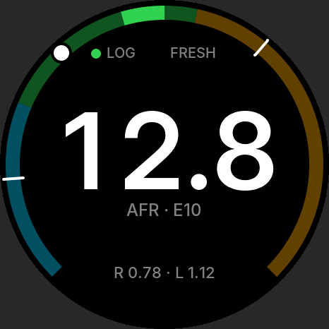
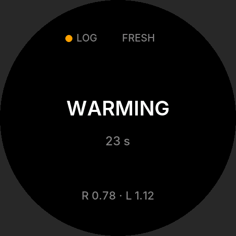
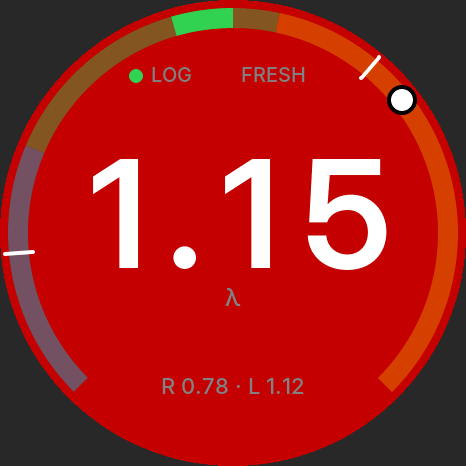

# Wideband AFR gauge

Firmware for a standalone in-car wideband air/fuel gauge. A 14Point7 Spartan 3 Lite v2 runs a Bosch LSU 4.9 sensor. Its 0–5 V output is read by an ADS1115 on a Waveshare ESP32-S3-Touch-AMOLED-1.75, which shows lambda/AFR on the 466 × 466 round screen, warns, holds peaks and logs to microSD. It only displays and logs; it never feeds the ECU.

Built from the *Wideband AFR Gauge – Technical Build Spec*. The hardware facts (Spartan interface, signal conditioning, board pins) are taken from it as given. Where the firmware departs from a design decision in it, the reason is under [Changes from the spec](#changes-from-the-spec).

| Ready (λ, AFR line on) | AFR on E10 | Calibrating | Warming |
| --- | --- | --- | --- |
|  |  |  |  |
| **Lean rail (overrun)** | **Lean warning** | **Strip chart** | **Settings** |
|  |  |  |  |

These are host renders of the real UI code through LVGL 9.4 (`test/ui_preview`). They are not photos of the panel.

## Status

| Part | Verified how |
| --- | --- |
| `afr_core`: conversion, calibration, LED decoder, state machine, peaks/warnings, smoothing, log format, settings, Spartan protocol | 85 Unity tests on the PC, also clean under ASan/UBSan. They cover every item in build step 1. |
| Replay | A simulated drive goes through the full 200 Hz path, is logged at 10/20/50 Hz, then replayed. States, warnings and peaks match (ctest). |
| UI | Rendered on the PC with LVGL 9.4 for every state and screen. |
| ESP-IDF drivers, logger, power, sampler, `app_main` | Type-checked against the ESP-IDF v5.5.5 headers with `-Wall -Wextra`. **Not yet built with `idf.py`** (the toolchain was not available where this was written). The CI `firmware` job is the first full build. |
| Anything on real hardware | Not yet: follow the build order below. |

## Layout

```
main/                 boot order, supervisor, sampler task (200 Hz)
components/
  afr_core/           pure C11, no ESP-IDF headers: all signal logic
  drv_ads1115/        ADS1115 on I2C1 (GPIO17/18), single-shot 860 SPS
  drv_spartan/        UART1 (TX 16, RX 44) commands, reply parser, task
  logger/             microSD session files, 4 KB chunks, fsync each second
  settings/           NVS load/save with schema version
  power/              AXP2101 VBUS watch and shutdown, PCF85063 clock
  ui/                 LVGL 9 screens; fonts/ generated from Inter
test/host/            Unity tests, afr_replay, afr_simlog (host gcc)
test/ui_preview/      renders the UI on the PC
tools/                replay.py, make_fonts.py, ui_frames_to_png.py
sim/spartan_sim/      Arduino sketch: simulated Spartan for the bench
```

## Build and flash

ESP-IDF **v5.5.5**, target ESP32-S3. The BSP and LVGL come from the component registry on the first build.

```sh
idf.py set-target esp32s3
idf.py build
idf.py -p /dev/ttyACM0 flash monitor
```

Console is on USB Serial/JTAG, so UART0/UART1 pins stay free. Options under `idf.py menuconfig`:

- **AFR gauge → Spartan supply sense fitted on AIN2.** Default off. Turn it on if you fit the optional 47 k/10 k divider on the red wire.
- **AFR gauge: Spartan UART → Command line ending.** Default CR LF. See open questions.
- `CONFIG_LV_USE_PERF_MONITOR=y` shows LVGL's frame-time monitor, for the "no frame over 100 ms" check.

`sdkconfig.defaults` sets `CONFIG_BSP_I2C_NUM=0`. The BSP puts its onboard bus on I2C port 1 by default, which is the controller the spec gives the ADS1115. The build fails with an error if this is changed back.

## Host tests, replay and UI preview

```sh
cmake -S test/host -B build/host && cmake --build build/host
ctest --test-dir build/host --output-on-failure     # add -DAFR_FETCH_UNITY=ON for real Unity

python3 tools/replay.py /path/to/20261026_090507.csv   # check a real drive against afr_core

cmake -S test/ui_preview -B build/ui_preview && cmake --build build/ui_preview
mkdir -p build/frames && build/ui_preview/ui_preview build/frames && python3 tools/ui_frames_to_png.py build/frames
```

The tests build offline with a small Unity-compatible header (`test/host/unity_min`); CI uses ThrowTheSwitch Unity v2.6.0. `replay.py` reads the log's `#` header lines (end points, fuel, warning settings, log rate) and replays at that rate. State changes within two rows of a logged change are reported but not counted as failures, because the gauge decides at 200 Hz and the log is decimated.

## Build order (from the spec)

1. **Host tests.** `ctest` as above.
2. **Display bring-up.** Flash with nothing on the header. The gauge shows FAULT "ADC not found", which proves the display, touch and LVGL work. For a sweep, run the simulated Spartan (step 4) on the bench.
3. **ADC check.** Put 0–5 V on the green input and compare *Settings → Service → v_out* with a multimeter at 0.5 V steps.
4. **Simulated Spartan.** `sim/spartan_sim` runs on any 5 V Arduino with an MCP4725. It plays the 1.666 V/3.333 V plateaus, then a drive with every LED pattern, rails and both warnings, and it answers the GET commands. The wiring is in the sketch header.
5. **First car run.** Check that the log has `# cal=FRESH ...` and that the decoded LED (service screen) matches the real LED. Check that `# spartan_fw=` is present, which means the Spartan answered over UART.
6. **Ignition-off torture test.** Cut power mid-log 20 times; every file must parse (`replay.py` will refuse a broken one).

## Using it

| Input | Action |
| --- | --- |
| Tap | Show or hide the AFR line |
| Long press (1 s) | Reset peaks |
| Swipe left / right | Strip chart (30 s of λ) / Settings |
| Settings → Clock, Service | Set the RTC; versions, calibration, ADC check with `SETLINOUT` (tap twice to send) |
| BOOT button | Day/night brightness |

The centre shows a number only in READY. In every other state it shows the state in words. A line under the status row flags `set clock` (RTC not valid), `CAL REJECTED`, or a sensor type that is not LSU 4.9. In the peak text, `*` after the rich peak means the rich rail was hit as well.

## Logs

`/sdcard/logs/YYYYMMDD_HHMMSS.csv`, or `S00001.csv` counting up when the RTC is not valid. The columns are `t_ms,state,lambda,afr,v_out,led,supply_v,warn,dropped`. Header lines start with `#`. Facts learnt after boot are appended as more `#` lines when they arrive: the Spartan's identity and end points, a fresh or rejected calibration, a clock change. Readers should skip `#` lines wherever they appear. At boot the previous session's file is cut back to its last complete row. Format cards FAT32 with 32 KB clusters.

## Changes from the spec

Design decisions changed, each with its reason:

- **LED decoder: SLOW on the first pulse.** A first pulse after a 0.75–2.5 s gap is also classified SLOW. With period timing alone, STEADY → SLOW took up to 3.75 s, which breaks the "correct state within 3 s" acceptance criterion. The test sweeps every pattern change and all are now under 3 s.
- **State machine additions.** WAIT_EXHAUST → WARMING also on a steady LED, WARMING → TOO_HOT on a fast LED, and TOO_HOT → WARMING on a slow LED. The rail states take the same LED transitions as READY. Without these the gauge could sit on a stale state if a phase was missed. A loss-of-power check takes priority, so supply < 8 V can't bounce with output > 1 V.
- **Warnings clear when λ is undefined** (WARMING, ENGINE OFF, FAULT), so the screen doesn't keep flashing red with no number. An active lean warning still survives the lean rail, as the spec's hysteresis rule says.
- **Calibration detection limit.** The 60 mV plateau window means a gain error over about 1.8 % is never detected at plateau 2. In practice the ±3 % acceptance on `a` therefore never binds; the window does instead. Both checks are implemented as written.
- **NVS keys** are limited to 15 characters, so `brightness_day/night` became `bright_day`/`bright_night`. `warn_lean` and `warn_rich` are stored as λ × 1000, with the hold times in `warn_lean_ms` and `warn_rich_ms`. The name of the last log is also kept in NVS, to find the file to repair at boot.
- **Ignition-off with a LiPo.** VBUS loss flushes the log at once. The gauge powers off only after VBUS has been gone for 1.5 s, so a cranking dip doesn't shut it down. The total is still under 2 s.
- **Spartan replies.** Blank lines and echoes of the command are skipped, and numeric queries take the first line with a digit. The command line ending is configurable.
- **Fonts.** These were made with `tools/make_fonts.py` (Pillow) instead of lv_font_conv, which needs Node. They use the same LVGL format, with tabular digits so the number doesn't shift sideways. Inter is under the SIL Open Font License 1.1. The label fonts carry λ and ·, which LVGL's built-in fonts lack.
- **`reading_t`** gained `warn`, `fault`, `state_since_ms`, `seq_progress` and the two peaks, for the UI and logger.
- The spec's `AFR = 10 + 2 V` is rounded: 0.68 × 14.7 = 9.996. The firmware uses λ × stoich.

## Open questions (confirm on the hardware)

The spec's list still applies: blue-wire lit voltage, UART reply format, 3.3 V into the Spartan RX, sequencer levels on the Lite v2, output between sequencer and warm-up, lead lengths, the battery connector, CO5300 partial-update alignment, car feeds, and the RTC without a LiPo. This build adds two:

- **Command line ending** the Spartan expects (CR, LF or CR LF): capture it alongside the reply format.
- **AXP2101 charge-current register.** The code sets 200 mA as step 8 of 25 mA, from XPowersLib's table. Confirm with the datasheet before fitting a LiPo.
