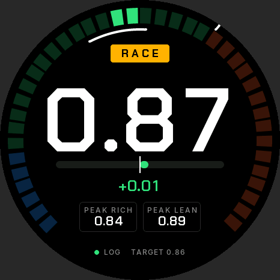
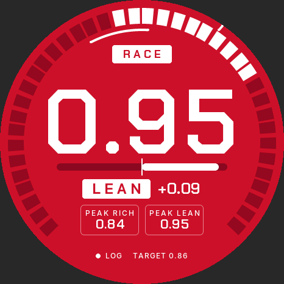
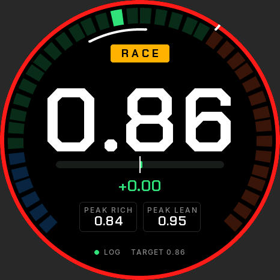
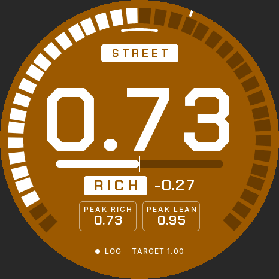

# Wideband AFR gauge

Firmware for a standalone in-car wideband lambda gauge built for drag racing. A 14Point7 Spartan 3 Lite v2 runs a Bosch LSU 4.9 sensor. Two ADS1115s on a Waveshare ESP32-S3-Touch-AMOLED-1.75 read it, and the board shows lambda/AFR on the 466 × 466 round screen. The screen turns red when the mixture goes too lean (amber when too rich), a double-tap switches between street and race limits, and every sample is logged to microSD. It only displays and logs; it never feeds the ECU.

It is built from the *Wideband AFR Gauge – Technical Build Spec*, with the measurement chain upgraded for accuracy (v2, below). Where the firmware departs from a design decision in the spec, the reason is under [Changes from the spec](#changes-from-the-spec).

| Race mode, on target | Race mode, lean warning | Lean ring after a lean-out | Street mode |
| --- | --- | --- | --- |
|  |  |  |  |
| **Rich warning** | **Calibrating** | **Full lean (fuel cut)** | **Settings** |
|  |  |  |  |

These are host renders of the real UI code through LVGL 9.4 (`test/ui_preview`). They are not photos of the panel.

## What it does, in numbers

| | |
| --- | --- |
| Lambda sampling | 860 SPS continuous, differential against the Spartan's own ground. Each conversion is timestamped by its ready pulse. |
| Processed rate | 215 Hz (blocks of 4: mean, or trimmed mean if one sample spikes) |
| Resolution | 0.00003 λ per ADC step, below the Spartan's own 12-bit DAC step (0.00017 λ) |
| Accuracy (simulated chain, every sample) | Within 0.002 λ from 0.5 to 4.5 V, after the start-up two-point calibration |
| Added delay | About 4.65 ms (one block) after the Spartan. The Spartan is held to its 10 ms response mode. |
| Race-mode lean warning | 20 ms from the Spartan's output crossing λ 0.92 to the warning (simulated chain, 15 ms hold); the screen is redrawn at once |
| Street-mode warnings | Lean above λ 1.05, rich below λ 0.75, after 300 ms |
| Logging | Every 215 Hz sample, unsmoothed, with a warning column. A 9.5 s queue rides out SD stalls. |

Everything runs at full rate all the time; there is no economy or cruise mode. Display smoothing (50 ms default) only affects the big number. Warnings, peaks and logs use the unsmoothed samples.

## Hardware v2

These changes to the spec's wiring are required by this firmware.

| Change | Why |
| --- | --- |
| **Second ADS1115**, ADDR to 3V3 (0x49), on the same I2C1 wires | It takes the LED and supply, so the first ADS1115 (ADDR to GND, 0x48) reads only lambda, continuously, and never stops to switch channels. |
| **Lambda read differentially**: green to AIN0, a **ground-sense wire** from the Spartan's black wire *at the Spartan* to AIN1, each through a 10 k/15 k divider | It cancels ground shift between the Spartan and the gauge under load (fuel pump, fans, alternator). The start-up calibration only removes a fixed offset. |
| **ALERT/RDY of the lambda ADS1115 to GPIO43** (header pin 5) through a **1 kΩ series resistor** | Each conversion is read once, timed to the microsecond. The resistor protects both pins: GPIO43 is the chip's UART0 TX and prints boot messages before the firmware takes it. |
| **220 nF** on the green and sense inputs (was 100 nF) | The input corner drops from 265 Hz to 120 Hz, so ignition noise doesn't alias into the reading. It adds about 1 ms of delay. |

**Second ADS1115 channels:** AIN0 blue LED wire, AIN2 optional supply sense (47 k/10 k), AIN1 and AIN3 spare. Both chips run from 3V3 (header pin 3). Generic ADS1115 modules work; check the chip is marked **BOGI** (an ADS1015, marked BRPI, is only 12-bit).

**BOM additions:** one ADS1115 breakout (~£3), two more 10 k/15 k resistors (the sense divider), two 220 nF C0G capacitors, one 1 kΩ resistor, and one more core in the screened signal cable (ground sense). 1 % metal-film resistors are enough: the start-up two-point calibration removes the divider's gain error at every power-up.

**Ground-sense wire:** take it from the Spartan's black wire as close to the Spartan as you can, and run it inside the screened cable with the green wire. If it's ever left off, the divider pulls AIN1 to the gauge's ground and the gauge behaves like the v1 single-ended wiring.

## The main screen

The layout follows a race dash:

- **Segmented bar** round the edge: λ from rich (blue) through safe (green) to lean (orange) for the current mode's limits. Segments light from the target to the reading. The white arc inside it is the target window (± 0.02); the white tick outside it is the lean limit.
- **Mode chip** at the top: STREET (outlined) or RACE (amber).
- **Big number**: λ, or AFR if chosen in Settings.
- **Delta bar** under the number: the centre line is the target. It grows right in orange when leaner, left in blue when richer, and is green within ± 0.02. Underneath: the difference and the AFR.
- **Peak rich / peak lean** boxes, and at the bottom the log state and the target, or a problem (calibration rejected, not calibrated, wrong sensor type) in amber.

Double-tap switches street / race; a long press resets the peaks and the lean ring (all inputs: [Using it](#using-it)).

## Warnings and race mode

Warnings are always armed and work on λ alone (the gauge has no throttle signal). A lean warning turns the whole screen red with a white LEAN tag; a rich warning turns it amber. Both go off as soon as λ is back 0.02 inside the limit.

| | Street | Race |
| --- | --- | --- |
| Lean warning | λ above 1.05 for 300 ms | λ above **0.92** for **15 ms** |
| Rich warning | λ below 0.75 for 300 ms | the same |
| Target (delta bar, target window) | 1.00 | **0.86** |
| Bar scale | λ 0.70–1.30 | λ 0.70–1.05 (zoomed in on full throttle) |

All of these are in Settings. The mode is saved, so the gauge comes back in the mode it was left in.

**Why these race limits** (naturally aspirated LS on petrol, from the research notes):

- **Target 0.86 (12.6:1).** The common NA Gen III/IV full-throttle target is λ 0.83–0.87 (12.2–12.8:1), with 12.5:1 the most quoted. Going leaner gains only 5–10 hp across that band, so most tuners stay on the rich side. Stock GM power enrichment is richer still, about λ 0.76–0.80.
- **Lean limit 0.92 (13.5:1).** About 13.2–13.5:1 (λ 0.90–0.92) is the leanest tuners accept at full throttle (C5 owners quote 13.4 as the outer bound). Real concern starts near λ 0.93–0.95, and an LS2 has been seen knocking at 13:1 at high rpm. 0.92 leaves room above a 0.86 tune for normal wander but catches a lean trend before the danger zone. If your tune runs leaner than 0.86, set the limit about 0.05 above your target.
- **Hold 15 ms.** About three processed samples: enough to ignore one disturbed sample, short enough that the gauge adds about 20 ms. The rest of the delay is the sensor (Bosch quotes under 50 ms for the LSU 4.9's response to a gas change) and the exhaust travel time to it, which the gauge can't change. The screen is redrawn the moment a warning starts, rather than on the next 15 ms refresh.
- **Rich 0.75 (11.0:1).** Richer than any sensible petrol tune, so it points to a fault (injector, regulator, wrong fuel setting) rather than danger.

**What race mode can't tell apart:** at idle, cruise and on the lift after a pass, λ is above 0.92, so the screen is red then too. This is the trade-off of having no throttle signal.

### The lean ring

When a lean warning ends and λ is back to safe, a red ring stays round the edge of the screen for 5 minutes, so a lean moment you missed while watching the track still shows. A long press clears it early. The log gets a `# lean_event=peak …` line.

The ring is only for a lean-out that recovered. These don't light it:
- **fuel cut on a lift** (the reading reaches the lean rail);
- **idle or cruise in race mode**: a lean warning that started straight after power-up or a mode change, or that lasted over 30 s;
- **a lean-out that runs straight into the lift.** The lift's fuel cut ends it on the lean rail, so the gauge can't tell it from an ordinary lift. You still see it live as the red screen, and it's in the log.

**Peaks** are the richest and leanest READY readings since the last long press. The lean peak includes lifts, because fuel cut reads lean.

## Status

| Part | Verified how |
| --- | --- |
| `afr_core`: conversion, decimation, calibration, LED decoder, state machine, warnings, race mode, lean ring, peaks, smoothing, log format, settings, Spartan protocol | 102 Unity tests on the PC. They include end-to-end runs at the real 860 SPS rate with chain errors and noise. |
| Replay | A simulated session (warm-up, a street pass, a race-mode pass that leans out and recovers, lifts and fuel cut) is logged at the full rate and replayed with 0 differences, and must light the lean ring exactly once (ctest). |
| UI | Rendered on the PC with LVGL 9.4 for every state and warning. |
| ESP-IDF build | The CI `firmware` job builds the full image with ESP-IDF v5.5.5. |
| Real hardware | Not yet: follow the build order below. |

## Layout

```
main/                 boot order, supervisor, sampler (RDY-driven) and aux tasks
components/
  afr_core/           pure C11, no ESP-IDF headers: all signal and warning logic
  drv_ads1115/        two ADS1115s on I2C1 (GPIO17/18): continuous + single-shot
  drv_spartan/        UART1 (TX 16, RX 44) commands, reply parser, task
  logger/             microSD session files, 4 KB chunks, fsync each second
  settings/           NVS load/save with schema version
  power/              AXP2101 VBUS watch and shutdown, PCF85063 clock
  ui/                 LVGL 9 screens; fonts/ generated from Inter
test/host/            Unity tests, afr_replay, afr_simlog (host gcc)
test/ui_preview/      renders the UI on the PC
tools/                replay.py, make_fonts.py, ui_frames_to_png.py
sim/spartan_sim/      Arduino sketch: simulated Spartan for the bench
```

## Build and flash

ESP-IDF **v5.5.5**, target ESP32-S3. The BSP and LVGL come from the component registry on the first build.

```sh
idf.py set-target esp32s3
idf.py build
idf.py -p /dev/ttyACM0 flash monitor
```

The console is on USB Serial/JTAG. `sdkconfig.defaults` moves the BSP's onboard bus to I2C0 (`CONFIG_BSP_I2C_NUM=0`), so I2C1 is free for the two ADS1115s; the build fails if that's changed back. Options under `idf.py menuconfig`: **AFR gauge → supply sense fitted**, **Spartan UART → command line ending**, and `CONFIG_LV_USE_PERF_MONITOR` for frame times.

## Host tests, replay and UI preview

```sh
cmake -S test/host -B build/host && cmake --build build/host
ctest --test-dir build/host --output-on-failure     # add -DAFR_FETCH_UNITY=ON for real Unity

python3 tools/replay.py /path/to/20261026_090507.csv   # check a real session against afr_core

cmake -S test/ui_preview -B build/ui_preview && cmake --build build/ui_preview
mkdir -p build/frames && build/ui_preview/ui_preview build/frames && python3 tools/ui_frames_to_png.py build/frames
```

## Build order

1. **Host tests.** `ctest` as above.
2. **Display bring-up.** Flash with nothing on the header. The gauge shows FAULT "Lambda ADC not found", which proves the display, touch and LVGL work.
3. **ADC check.** Fit both ADS1115s. Put 0–5 V on the green input (sense input to ground), then compare *Settings → Service → v_out* with a multimeter at 0.5 V steps. The service screen also counts conversions, missed reads, ready-pulse gaps and spikes; on a clean bench, missed and gaps stay at 0.
4. **Simulated Spartan.** `sim/spartan_sim` runs on a 5 V Arduino with an MCP4725. It plays the start-up plateaus and a session with a lean-out, fuel cuts and rich moments, each of which should show its warning. The wiring is in the sketch header.
5. **First car run.** The log should hold `# cal=FRESH ...`, `# spartan_fw=...` and `# spartan_perf=1`.
6. **Ignition-off torture test.** Cut power mid-log 20 times; every file must parse (`replay.py` refuses a broken one).

## Logs

`/sdcard/logs/YYYYMMDD_HHMMSS.csv` (or `S00001.csv` when the RTC isn't valid). The columns are:

`t_ms,state,lambda,afr,v_out,led,supply_v,alarm,mode,dropped`

`alarm` is the warning: `0`, `R` (rich) or `L` (lean). `mode` is `S` (street) or `R` (race). Every processed sample is logged, about 215 rows/s or roughly 46 MB per hour.

Header lines start with `#` and record the firmware, fuel, calibration, end points, the mode and both modes' warning settings. Later facts are appended as `#` lines when they happen: the Spartan's identity and response mode, a fresh or rejected calibration, each warning (`# warning=LEAN t_ms=… lambda=…`), each lean-out that lit the ring (`# lean_event=peak 0.960, 400 ms …`), settings changes, and a clock change. `replay.py` reads those settings from the header. At boot the previous file is cut back to its last complete row. Format cards FAT32 with 32 KB clusters.

## Using it

| Input | Action |
| --- | --- |
| Double-tap | Street / race mode |
| Long press (1 s) | Reset peaks and the lean ring |
| Swipe left / right | Strip chart (30 s of λ) / Settings |
| Settings → Clock, Service | Set the RTC; versions, calibration, ADC statistics, ADC check with `SETLINOUT` (tap twice) |
| BOOT button | Day/night brightness |

## Changes from the spec

- **Wiring (v2).** As above: a second ADS1115, differential lambda with a ground-sense wire, ALERT/RDY on GPIO43, and 220 nF input caps. The spec's single round-robin ADC took a 1.2 ms snapshot every 5 ms with ±1 ms timing jitter, and its 265 Hz input filter let ignition noise alias into the reading.
- **Warnings** hold for 300 ms (the spec had 1 s and 2 s) and flash the whole screen. The lean warning also covers the lean rail, which the spec ignored: a lean-out past λ 1.36 at full throttle would otherwise never warn.
- **Every sample is logged** (no log-rate setting), and the logger queue moved to PSRAM (2048 rows).
- **Spartan response mode** is a setting, defaulting to 10 ms, and is enforced at every Spartan power-up.
- **Display smoothing** defaults to 50 ms (was 100 ms).
- **LED decoder:** a first pulse after a 0.75–2.5 s gap is classified SLOW. Without this rule, STEADY → SLOW took up to 3.75 s, which breaks the "correct state within 3 s" criterion.
- **State machine additions:** WAIT_EXHAUST → WARMING also on a steady LED, WARMING → TOO_HOT on a fast LED, TOO_HOT → WARMING on a slow LED, and the rails take READY's LED transitions.
- **Calibration detection limit:** the 60 mV plateau window means gain errors over about 1.8 % are never detected, so the ±3 % acceptance on `a` never binds in practice.
- **NVS keys** are limited to 15 characters. Lambda limits are stored as λ × 1000. Settings schema 3 replaces the earlier ones (defaults load once on upgrade).
- **Ignition-off with a LiPo:** VBUS loss flushes the log at once. The gauge powers off after 1.5 s without VBUS, so a cranking dip doesn't shut it down.
- **Fonts:** generated by `tools/make_fonts.py`. The main screen uses Chakra Petch, the menus Inter (both SIL OFL 1.1; licence in `docs/licenses/`). Digits are tabular, and λ comes from Inter because Chakra Petch has none.
- **Main screen** redesigned as a race dash (above), replacing the spec's arc and marker.
- The spec's `AFR = 10 + 2 V` is rounded: 0.68 × 14.7 = 9.996. The firmware uses λ × stoich.

## Open questions (confirm on the hardware)

The spec's list still applies: blue-wire lit voltage, UART reply format, 3.3 V into the Spartan RX, sequencer levels on the Lite v2, output between sequencer and warm-up, lead lengths, the battery connector, CO5300 partial-update alignment, car feeds, and the RTC without a LiPo. This build adds:

- **Command line ending** the Spartan expects (CR, LF or CR LF).
- **Whether `SETPERF` persists** in the Spartan. The gauge re-applies it at each power-up either way.
- **AXP2101 charge-current register** (200 mA as step 8 of 25 mA, from XPowersLib). Confirm with the datasheet before fitting a LiPo.
